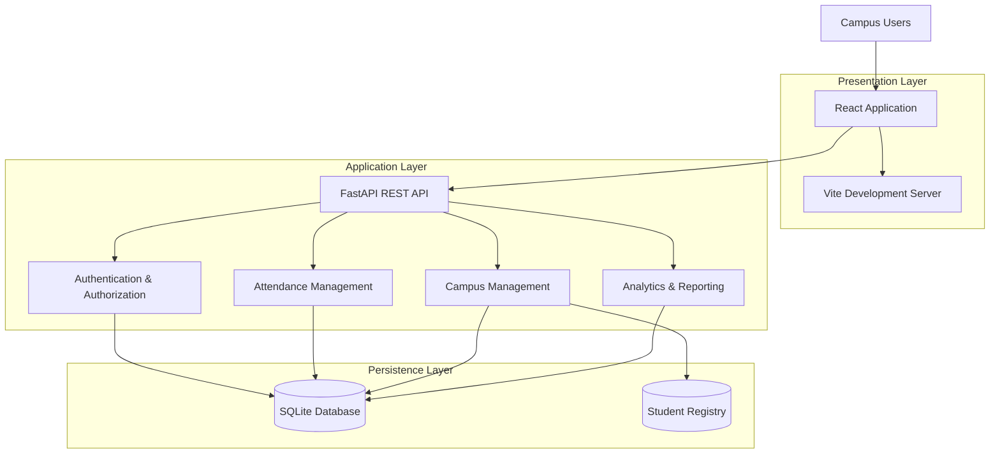
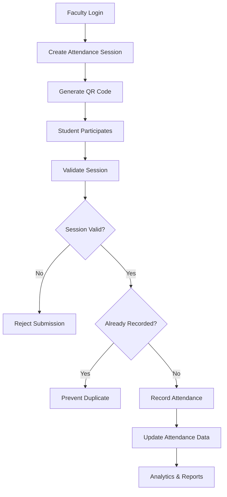
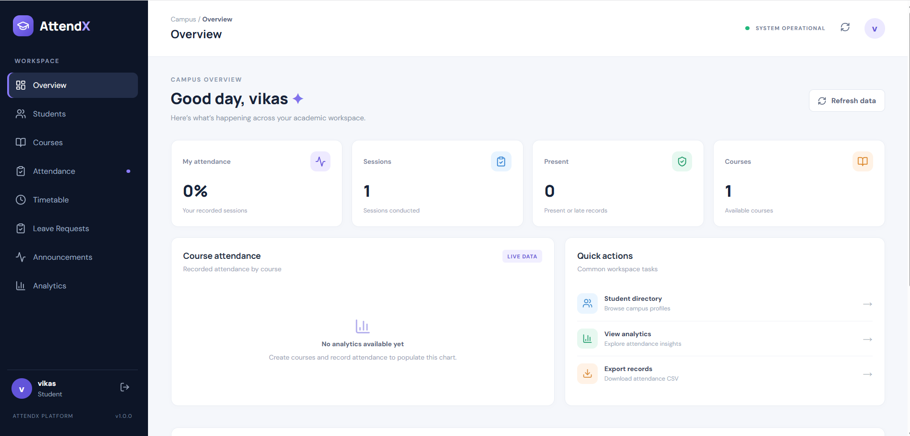
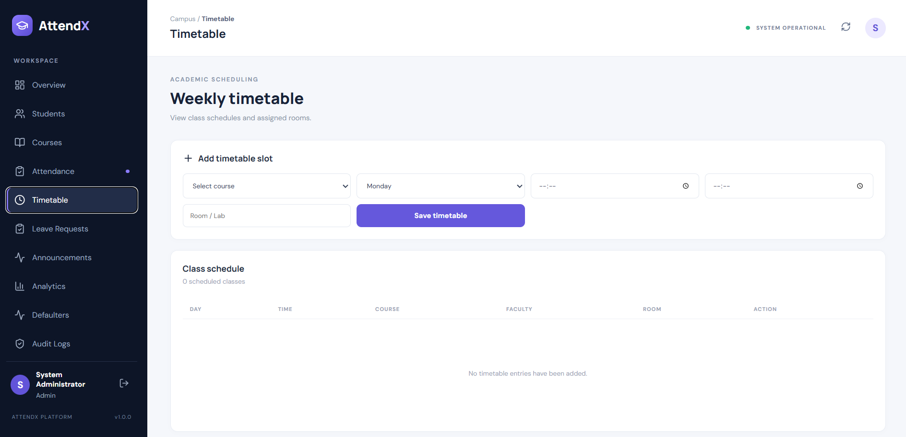
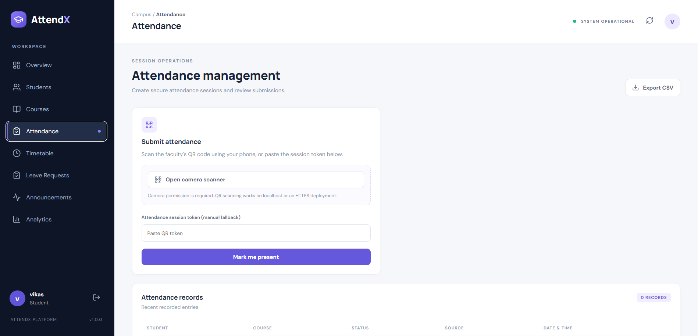
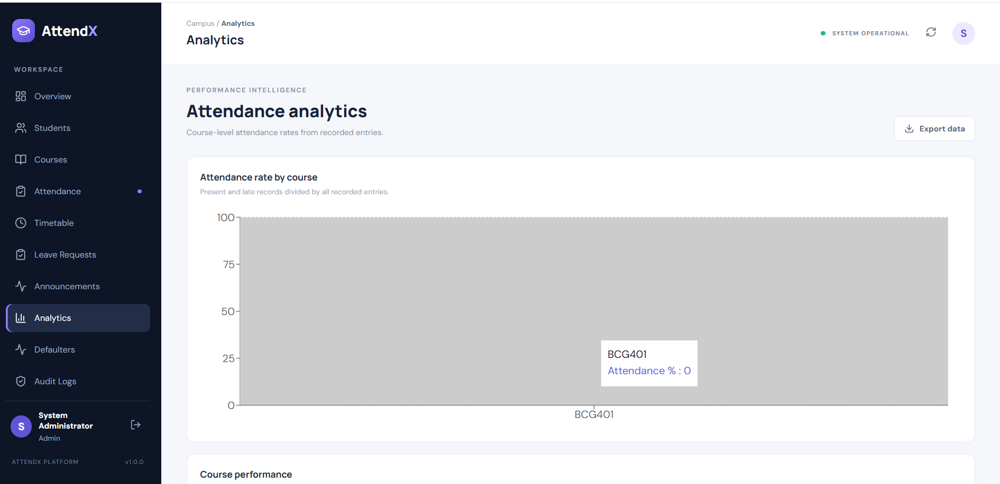

# ⚡ AttendX
### The Intelligence Behind a Smarter Campus.

<p align="center">
  
</p>

<p align="center">
  
  
  
</p>

<p align="center">
  <b>A centralized digital ecosystem for attendance, academic coordination, and campus operations.</b>
</p>

<p align="center">
  <a href="#-product-overview">Overview</a> •
  <a href="#-platform-capabilities">Capabilities</a> •
  <a href="#-system-architecture">Architecture</a> •
  <a href="#-engineering-design">Engineering</a> •
  <a href="#-installation">Installation</a>
</p>

---

<!-- Replace this banner with a custom AttendX project banner when available. -->

<p align="center">
  
</p>

# ◈ 01 — Product Overview

**AttendX** is a full-stack Smart Campus Attendance Management System designed to digitize and simplify everyday academic operations.

Traditional attendance management often involves repetitive manual processes, fragmented student records, limited reporting capabilities, and inefficient communication between students and faculty.

AttendX approaches this problem through a centralized platform that connects three key campus stakeholders:

- **Administrators** — Campus-wide management and monitoring.
- **Faculty** — Classroom attendance and academic coordination.
- **Students** — Personal attendance access and campus services.

The platform combines QR-based attendance workflows, manual attendance management, student registration, attendance analytics, and campus coordination tools in one application.

### The Core Idea

<table>
<tr>
<td align="center" width="25%">
<h2>01</h2>
<b>Capture</b>
<br/>Digitize classroom attendance.
</td>
<td align="center" width="25%">
<h2>02</h2>
<b>Manage</b>
<br/>Centralize academic records.
</td>
<td align="center" width="25%">
<h2>03</h2>
<b>Analyze</b>
<br/>Understand attendance patterns.
</td>
<td align="center" width="25%">
<h2>04</h2>
<b>Connect</b>
<br/>Coordinate campus activities.
</td>
</tr>
</table>

---

# ◈ 02 — Platform Capabilities

## A. Attendance Intelligence

| Capability | Implementation |
|---|---|
| QR Attendance | QR-enabled attendance session workflow |
| Session Validation | Session expiry and token validation |
| Duplicate Prevention | Prevent repeated attendance submissions |
| Manual Attendance | Faculty-managed attendance recording |
| Attendance History | Maintain attendance records |
| Attendance Analytics | Summarize attendance information |
| CSV Export | Export attendance data for reporting |

## B. Campus Administration

| Module | Responsibility |
|---|---|
| Student Management | Student records and registration |
| Faculty Management | Faculty account administration |
| Timetable | Academic schedule coordination |
| Leave Management | Student leave requests |
| Announcements | Campus-wide communication |
| Defaulter Watchlist | Identify low-attendance students |
| Audit Logs | Track recorded system activities |

## C. Role-Based Experience

<details>
<summary><b>🎓 Student Portal</b></summary>

- Access personal attendance information.
- Participate in attendance workflows.
- Submit leave requests.
- View campus announcements.
- Stay informed about attendance status.

</details>

<details>
<summary><b>👨‍🏫 Faculty Portal</b></summary>

- Manage classroom attendance.
- Create QR-enabled attendance sessions.
- Record attendance manually.
- Review attendance statistics.
- Coordinate timetable and academic activities.

</details>

<details>
<summary><b>🛡️ Administrator Portal</b></summary>

- Manage student and faculty information.
- Oversee attendance operations.
- Access centralized reports.
- Monitor campus activities.
- Manage administrative records.

</details>

---

# ◈ 03 — System Architecture

AttendX follows a layered client-server architecture with a React-based frontend, FastAPI backend, and SQLite persistence layer.



### Architectural Responsibilities

| Layer | Technology | Responsibility |
|---|---|---|
| Presentation | React + Vite | User interaction and interface rendering |
| API | FastAPI | Request handling and application services |
| Authentication | JWT-based authentication | User authentication and access control |
| Data Access | SQLAlchemy | Database interaction |
| Persistence | SQLite | Application data storage |
| Registration | Separate student registry | Student registration data management |

---

# ◈ 04 — Attendance Workflow

The attendance workflow is designed around controlled session-based recording.



### Workflow Objectives

- Ensure attendance submissions are associated with valid sessions.
- Prevent duplicate attendance records.
- Support manual attendance as an alternative workflow.
- Maintain attendance information for reporting and review.

---

# ◈ 05 — Technology Ecosystem

<p align="center">
  
</p>

| Technology | Role in AttendX |
|---|---|
| React.js | Component-based frontend |
| Vite | Frontend development and build tooling |
| JavaScript | Client-side application logic |
| HTML5 / CSS3 | Interface structure and styling |
| Python 3.11 | Backend programming language |
| FastAPI | REST API framework |
| SQLAlchemy | Database ORM |
| SQLite | Relational data storage |
| JWT | Authentication mechanism |
| Git / GitHub | Version control and collaboration |

---

# ◈ 06 — Engineering Design

## Authentication & Access Control

AttendX uses a role-oriented authentication model.

```text
                 AUTHENTICATION
                       |
                User Credentials
                       |
                 Token Validation
                       |
                Identify User Role
                       |
          ┌────────────┼────────────┐
          |            |            |
       ADMIN         FACULTY      STUDENT
          |            |            |
       Admin         Faculty       Student
       Modules       Modules       Modules
```

## Data Management

The application separates frontend, backend, and persistence responsibilities.

- The frontend communicates with the backend through API requests.
- The backend handles application logic and data operations.
- SQLAlchemy provides database interaction.
- SQLite stores application records.
- The student registry uses a separate database component.

## Reliability Considerations

| Concern | Design Approach |
|---|---|
| Duplicate submissions | Attendance duplicate prevention |
| Expired sessions | Session validation |
| Unauthorized access | Authentication and role-based permissions |
| Data consistency | Structured database operations |
| Operational visibility | Audit log functionality |
| Reporting | CSV export and attendance summaries |

---

# ◈ 07 — Repository Structure

```text
AttendX/
│
├── backend/
│   ├── main.py                 # API entry point
│   ├── database.py             # Database configuration
│   ├── models.py               # Database models
│   ├── schemas.py              # Data schemas
│   ├── student_registry.py     # Student registry component
│   ├── requirements.txt        # Python dependencies
│   └── .env.example            # Environment template
│
├── frontend/
│   ├── src/
│   │   ├── main.jsx            # Frontend application
│   │   └── style.css           # Application styles
│   ├── index.html
│   ├── package.json
│   └── package-lock.json
│
├── .gitignore
├── README.md
├── setup_windows.bat
└── start_attendx.bat
```

---

# ◈ 08 — Installation

### System Requirements

| Dependency | Version |
|---|---|
| Python | 3.11 recommended |
| Node.js | Compatible with installed Vite dependencies |
| npm | Installed with Node.js |
| Git | Latest stable version |

### Step 01 — Clone Repository

```bash
git clone https://github.com/kishoreb13/AttendX.git
cd AttendX
```

### Step 02 — Configure Backend

```powershell
cd backend
python -m venv .venv
.\.venv\Scripts\Activate.ps1
pip install -r requirements.txt
```

### Step 03 — Start API Server

```powershell
python -m uvicorn main:app --reload --host 127.0.0.1 --port 8000
```

### Step 04 — Configure Frontend

Open a second terminal:

```powershell
cd frontend
npm install
npm run dev
```

### Step 05 — Access the Application

| Component | Local Address |
|---|---|
| Frontend | http://localhost:5173 |
| Backend | http://127.0.0.1:8000 |
| Swagger API Documentation | http://127.0.0.1:8000/docs |

---

# ◈ 09 — Application Showcase

<p align="center">
  <b>THE INTERFACE IN ACTION</b>
  <br/>

<table>
<tr>
<td width="50%" align="center">

<b>01 — Dashboard</b>
</td>
<td width="50%" align="center">

<b>02 — Attendance Management</b>
</td>
</tr>
<tr>
<td width="50%" align="center">

<b>03 — Student Management</b>
</td>
<td width="50%" align="center">

<b>04 — Attendance Analytics</b>
</td>
</tr>
</table>

---

# ◈ 10 — Development Roadmap

| Enhancement | Status |
|---|---|
| Core full-stack application | In development |
| Role-based access | Implemented in project scope |
| QR attendance workflow | Implemented in project scope |
| Manual attendance | Implemented in project scope |
| Attendance analytics | Implemented in project scope |
| Advanced camera scanning | Planned |
| Cloud deployment | Planned |
| Mobile application | Planned |
| Predictive attendance insights | Planned |

---

# ◈ 11 — Project Information

| Attribute | Details |
|---|---|
| Project | AttendX |
| Category | Full-Stack Web Application |
| Domain | Smart Campus / EdTech |
| Frontend | React.js |
| Backend | FastAPI |
| Database | SQLite |
| Repository | [GitHub — AttendX](https://github.com/kishoreb13/AttendX) |
| Development | Ongoing |

---

<p align="center">
  
</p>

<p align="center">
  <b>ATTENDX</b>
  <br/>
  <i>Turning campus operations into connected experiences.</i>
  <br/><br/>
  Built with precision. Designed for smarter campuses.
  <br/><br/>
  <a href="https://github.com/kishoreb13/AttendX">Explore the Repository</a>
</p>
